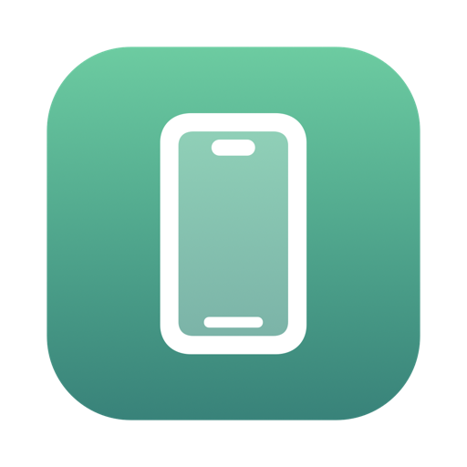
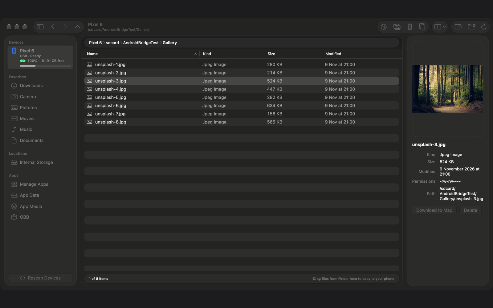
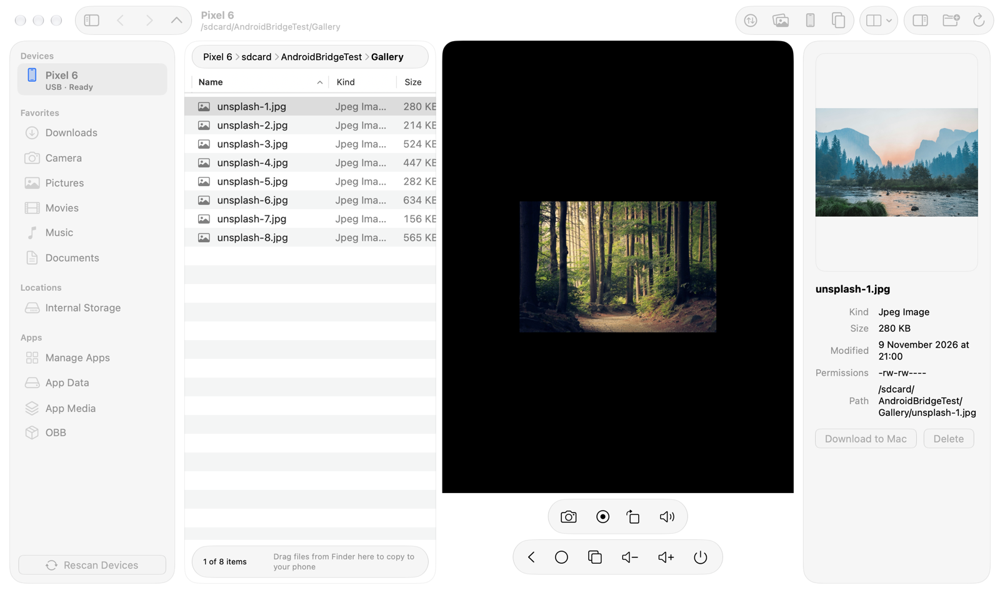
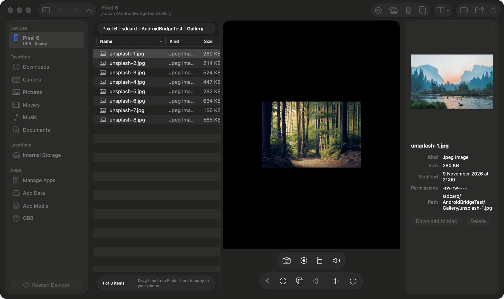

  

<h1 align="center">AFS for Mac</h1>

<b>Browse, copy and mirror your Android phones on your Mac — in one window.</b> 
Native macOS app. USB. No account, no cloud, no data collection.

  
  
  

<a href="README.vi.md">🇻🇳 Tiếng Việt</a>

  

## Features

**Files**
- Several phones at once, with a sidebar of favorite folders (Downloads, Camera, Pictures, Movies, Music, Documents), internal storage and app folders
- Browse, rename, create folders, delete, show hidden files, back/forward/up history
- Instant preview of images and videos in the inspector, with size, permissions and path
- Drag files from Finder onto the window (or onto the phone screen) to copy them to the phone; download to your Mac with one click

**Transfers**
- Fast direct transfers with a queue, live progress, cancel, and conflict handling (ask / keep both / replace / skip)
- Copy between two connected phones
- Photo & video import: scans DCIM / Pictures / Movies and copies only new items into `YYYY/YYYY-MM` folders, never overwriting

**Screen mirroring & control**
- Live phone screen next to your files (or in its own window), with touch, keyboard, scroll and Vietnamese (Telex) text input
- Two-way clipboard, device audio, rotate, screenshot and screen recording
- Back / Home / Recents / volume / power buttons

**Apps & device**
- Manage apps: list, install APK, uninstall
- Battery level and storage at a glance

**Made for the Mac**
- SwiftUI, Liquid Glass on macOS 26, Light / Dark, English and Vietnamese
- Bundled `adb` and `scrcpy-server` — nothing else to install

| Mirror (light) | Mirror (dark) |
|---|---|
|  |  |

> Screenshots use sample photos from [Unsplash](https://unsplash.com).

## Requirements

- macOS 14 Sonoma or later (Apple silicon and Intel)
- An Android phone with **USB debugging** enabled and a data-capable USB cable
- Audio capture needs Android 11+; screen mirroring works on Android 5+ (tested on Android 12 and 17)

## Install

1. Download the latest `AFS-for-Mac-x.y.z.dmg` from [Releases](https://github.com/hoangvunam/afs-for-mac/releases/latest), open it and drag **AFS for Mac** to Applications. The app is signed with Developer ID and notarized by Apple.
2. On the phone: **Settings → About phone →** tap *Build number* 7 times, then **Settings → System → Developer options → USB debugging**.
3. Connect the phone by USB and tap **Allow** on the "Allow USB debugging?" prompt (tick *Always allow*).

**Mac App Store version:** it runs inside the App Sandbox with its own adb key, so you must tap **Allow USB debugging** on the phone once more the first time you connect.

## FAQ

**The phone shows "Unauthorized" or does not appear.** Unlock the phone, replug the cable, and accept the USB debugging prompt. Try *Revoke USB debugging authorizations* in Developer options if the prompt never appears. Make sure the cable supports data and the USB mode is not "charging only".

**Do I need to install adb or scrcpy?** No. Both are bundled. If another `adb` of a different version is already running, adb restarts its server once — this is normal.

**Does it work over Wi-Fi?** Not yet; USB only in 1.0.

**Is my data sent anywhere?** No. Everything goes directly between your Mac and your phone over USB. There are no accounts, analytics or network calls to our servers.

**File names with accents or emoji?** Supported (Unicode is preserved end to end).

**Why does the phone screen not show for some apps?** Apps that block screen capture (e.g. banking apps using `FLAG_SECURE`) appear black — this is enforced by Android.

## Privacy

AFS for Mac collects no data. See the [Privacy Policy](https://androidfiletransfer.tunacorp.app/privacy) and [Terms of Use](https://androidfiletransfer.tunacorp.app/terms).

## Third-party software

- [scrcpy](https://github.com/Genymobile/scrcpy) server (v3.1) — © Genymobile, Apache License 2.0
- Android SDK Platform-Tools (`adb`) — © The Android Open Source Project, Apache License 2.0; downloaded from Google's official distribution

Full notices are in the app (*Settings → About → Open Third-Party Notices*).

## Support

Email [tunacorp.app@gmail.com](mailto:tunacorp.app@gmail.com) or visit the [support page](https://androidfiletransfer.tunacorp.app/support).

---

This repository only hosts release downloads and documentation; it does not contain the source code.
© 2026 Hoàng Vũ Nam (TUNA Corp). Android is a trademark of Google LLC. AFS for Mac is an independent product and is not affiliated with or endorsed by Google.
