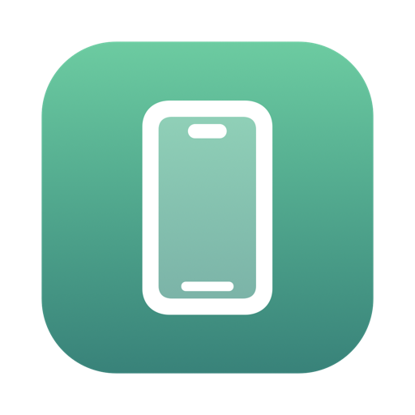
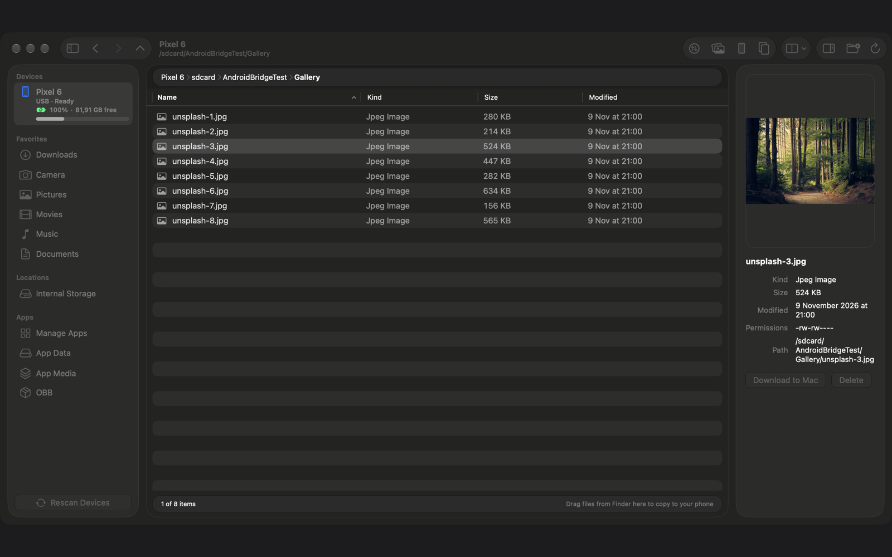
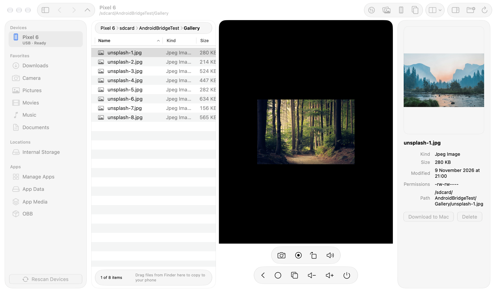
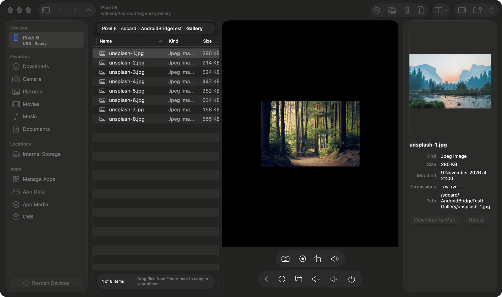

  

<h1 align="center">AFS for Mac</h1>

<b>Duyệt tệp, chép tệp và xem/điều khiển màn hình nhiều điện thoại Android ngay trên Mac — trong một cửa sổ.</b> 
Ứng dụng macOS thuần, kết nối USB. Không tài khoản, không đám mây, không thu thập dữ liệu.

  
  
  

<a href="README.md">🇬🇧 English</a>

  

## Tính năng

**Tệp**
- Nhiều điện thoại cùng lúc; thanh bên có thư mục yêu thích (Tải về, Camera, Ảnh, Phim, Nhạc, Tài liệu), bộ nhớ trong và thư mục ứng dụng
- Duyệt, đổi tên, tạo thư mục, xóa, hiện tệp ẩn, lịch sử tiến/lùi/lên
- Xem trước ảnh và video ngay trong khung thông tin, kèm dung lượng, quyền và đường dẫn
- Kéo tệp từ Finder thả vào cửa sổ (hoặc lên màn hình điện thoại) để chép sang điện thoại; tải về Mac chỉ một cú bấm

**Truyền tệp**
- Truyền trực tiếp nhanh, có hàng đợi, tiến độ thật, hủy, xử lý trùng tên (hỏi / giữ cả hai / thay thế / bỏ qua)
- Hai điện thoại cạnh nhau (chia đôi cửa sổ)
- Nhập ảnh/video: quét DCIM / Pictures / Movies, chỉ chép mục mới vào thư mục `YYYY/YYYY-MM`, không bao giờ ghi đè

**Xem và điều khiển màn hình**
- Màn hình điện thoại hiển thị cạnh danh sách tệp (hoặc tách thành cửa sổ riêng); cảm ứng, bàn phím, cuộn, gõ tiếng Việt (Telex)
- Clipboard hai chiều, âm thanh thiết bị, xoay màn hình, chụp màn hình, quay video
- Nút Quay lại / Trang chủ / Đa nhiệm / âm lượng / nguồn

**Ứng dụng và thiết bị**
- Quản lý ứng dụng: danh sách, cài APK, gỡ cài đặt
- Xem pin và dung lượng nhanh

**Dành riêng cho Mac**
- SwiftUI, Liquid Glass trên macOS 26, Sáng/Tối, tiếng Việt và tiếng Anh
- Kèm sẵn `adb` và `scrcpy-server` — không cần cài thêm gì

| Màn hình (sáng) | Màn hình (tối) |
|---|---|
|  |  |

> Ảnh chụp dùng ảnh mẫu từ [Unsplash](https://unsplash.com).

## Yêu cầu

- macOS 14 Sonoma trở lên (Apple silicon và Intel)
- Điện thoại Android đã bật **Gỡ lỗi USB** và cáp USB truyền dữ liệu
- Thu âm thanh cần Android 11+; đã thử trên Android 12 và 17

## Cài đặt

1. Tải `AFS-for-Mac-x.y.z.dmg` mới nhất ở [Releases](https://github.com/hoangvunam/afs-for-mac/releases/latest), mở ra và kéo **AFS for Mac** vào Applications. Ứng dụng được ký Developer ID và Apple notarize.
2. Trên điện thoại: **Cài đặt → Giới thiệu điện thoại →** chạm *Số bản dựng* 7 lần, rồi **Cài đặt → Hệ thống → Tùy chọn nhà phát triển → Gỡ lỗi USB**.
3. Cắm USB và chạm **Cho phép** ở hộp thoại "Cho phép gỡ lỗi USB?" (chọn *Luôn cho phép*).

**Bản Mac App Store:** chạy trong App Sandbox với khóa adb riêng, nên lần đầu kết nối bạn phải chạm **Cho phép gỡ lỗi USB** thêm một lần nữa trên điện thoại.

## Câu hỏi thường gặp

**Điện thoại báo "Chưa cấp quyền" hoặc không hiện.** Mở khóa máy, cắm lại cáp và chấp nhận hộp thoại gỡ lỗi USB. Nếu hộp thoại không bao giờ hiện, thử *Thu hồi ủy quyền gỡ lỗi USB* trong Tùy chọn nhà phát triển. Kiểm tra cáp có truyền dữ liệu và chế độ USB không phải "chỉ sạc".

**Có cần cài adb hay scrcpy không?** Không, đã kèm sẵn. Nếu máy đang chạy một `adb` khác phiên bản, adb sẽ khởi động lại server một lần — bình thường.

**Có dùng qua Wi-Fi được không?** Chưa; bản 1.0 chỉ qua USB.

**Dữ liệu của tôi có bị gửi đi đâu không?** Không. Mọi thứ đi thẳng giữa Mac và điện thoại qua USB; không có tài khoản, thống kê hay kết nối tới máy chủ của chúng tôi.

**Tên tệp có dấu tiếng Việt hoặc emoji?** Hỗ trợ đầy đủ (giữ nguyên Unicode).

**Vì sao một số ứng dụng hiện màn hình đen?** Ứng dụng chặn chụp màn hình (ví dụ ngân hàng dùng `FLAG_SECURE`) sẽ đen — do Android áp đặt.

## Quyền riêng tư

AFS for Mac không thu thập dữ liệu. Xem [Chính sách quyền riêng tư](https://androidfiletransfer.tunacorp.app/privacy) và [Điều khoản sử dụng](https://androidfiletransfer.tunacorp.app/terms).

## Phần mềm bên thứ ba

- Server [scrcpy](https://github.com/Genymobile/scrcpy) (v3.1) — © Genymobile, giấy phép Apache 2.0
- Android SDK Platform-Tools (`adb`) — © The Android Open Source Project, giấy phép Apache 2.0; tải từ kênh phân phối chính thức của Google

Thông báo đầy đủ nằm trong app (*Cài đặt → Giới thiệu → Mở thông báo bản quyền*).

## Hỗ trợ

Email [tunacorp.app@gmail.com](mailto:tunacorp.app@gmail.com) hoặc [trang hỗ trợ](https://androidfiletransfer.tunacorp.app/support).

---

Repo này chỉ chứa bản tải và tài liệu; không chứa mã nguồn.
© 2026 Hoàng Vũ Nam (TUNA Corp). Android là nhãn hiệu của Google LLC. AFS for Mac là sản phẩm độc lập, không liên kết hay được Google bảo trợ.
